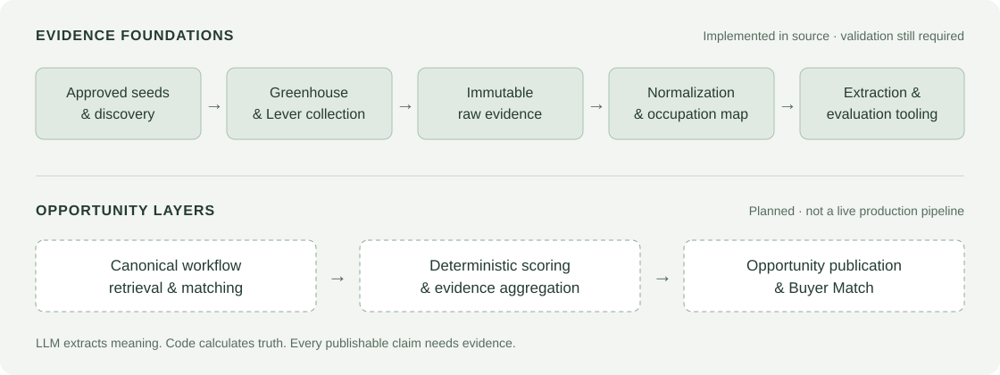

# SIGNAL

### Find the work. Understand the evidence. Evaluate the opportunity.

SIGNAL is a product in development for automation agencies and consultants.
Its goal is to connect hiring evidence with occupational and economic references
so users can investigate repeated manual workflows and companies that perform them.

**Status:** In development · **Role:** Product design and engineering · **Author:** Vladyslav Moskalkov

> This is a public, documentation-only showcase. The implementation and internal
> development history remain private. SIGNAL is not a launched service, a
> validated lead database, or a promise of automation ROI.

## The problem

Choosing an automation opportunity requires more than a plausible idea. Agencies
need to understand what work is repeated, which companies actually perform it,
what economic evidence exists, and where human judgment is still necessary.

SIGNAL is being designed around those questions, with traceable evidence instead
of unsupported market claims.

## Approach

- **Observe the work:** collect permitted company hiring evidence and preserve its source lineage.
- **Extract meaning:** identify supported tasks with structured AI output and exact evidence references.
- **Keep economics grounded:** distinguish employer-declared salary from aggregate wage benchmarks.
- **Calculate in code:** use versioned deterministic formulas, not model-generated scores.
- **Expose uncertainty:** separate opportunity attractiveness, Confidence and Buyer Match.

A job posting demonstrates recruiting activity. It does **not** prove purchase
intent. Missing evidence stays missing; unavailable sources must not look like
falling demand.

## System direction

The diagram distinguishes implemented foundations from planned product layers.
It is a high-level architecture summary, not a claim that the full pipeline is live.

## Current progress

| Area                                                                              | Status                                                     |
| --------------------------------------------------------------------------------- | ---------------------------------------------------------- |
| PostgreSQL schema, explicit migrations and reference-data importers               | Implemented in source                                      |
| Company seed import, bounded discovery and Greenhouse/Lever collectors            | Implemented in source                                      |
| Hiring normalization, source salary handling and occupation mapping               | Implemented in source                                      |
| Structured extraction contracts, provider adapters and private evaluation tooling | Implemented foundations; full semantic pipeline incomplete |
| Company intelligence, hiring details, signal explorer and search                  | Internal read-only web foundation                          |
| Canonical workflow matching, final scoring and opportunity publication            | Planned / not complete                                     |
| Full engine validation, authenticated commercial product and private beta         | Not complete                                               |

Local lint, type checks, offline tests and build passed during repository
packaging. Those checks do not establish model accuracy, live integration
reliability, production readiness or customer outcomes.

## Scope and expansion

**The first MVP validation scope is US Accounting & Bookkeeping.** It gives the
initial engine a bounded domain with occupational and wage references. It is
not a permanent geographic limit or a statement that the eventual product can
only serve the US.

Other markets would require appropriate sources, reference data, normalization
and validation. International coverage is not implemented or advertised today.

## Technology

**TypeScript · Next.js · React · PostgreSQL · Drizzle ORM**

Provider-neutral AI contracts with OpenAI/Anthropic adapters. pnpm/Turborepo
workspace with ESLint, Prettier and Vitest.

The architecture keeps collection, model execution and secrets on the server.
Raw evidence is immutable; model-run and derived-result provenance are explicit.

## Public-sharing boundary

This showcase contains only a high-level product overview, original diagrams and
an honest progress summary. It excludes source corpora, database dumps, private
annotations, approval records, provider credentials, execution logs and internal
legal/operational documents. The absence of a software license here is not a
grant of rights to the private implementation.

## Connect

[LinkedIn](https://www.linkedin.com/in/vladyslav-moskalkov/) ·
[Automation portfolio](https://vladyslav-ai-automation.notion.site/AI-Automation-Portfolio-3917a4cb52cc81408f7cebb09a5d14ce) ·
[Email](mailto:vladyslavmoskalkov@gmail.com)

This showcase reflects the implementation snapshot of 3 October 2026 and was
prepared on 4 October 2026. No client results, market-size estimates or commercial
performance metrics are claimed.
